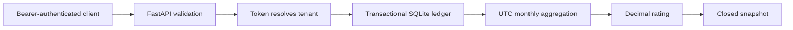

# Usage Metering Service

A small, runnable backend demo for a SaaS usage ledger: tenant-scoped event ingestion, retry-safe writes, monthly rating with exact decimal arithmetic, and immutable closed-period snapshots. Uses synthetic example usage, not customer or employer data.

## Review in five minutes

```bash
uv sync --frozen
uv run pytest -q
export METER_API_KEYS='{"local-demo-alpha":"alpha","local-demo-beta":"beta"}'
uv run uvicorn metering.api:create_app --factory
```

Open http://127.0.0.1:8000/docs for the interactive API. The example tokens are public demo values: run locally only. The application refuses to start without an explicit token-to-tenant map.

```bash
curl -s http://127.0.0.1:8000/v1/events \
  -H 'Authorization: Bearer local-demo-alpha' \
  -H 'Content-Type: application/json' \
  -d '{"event_id":"batch-001","meter":"api_calls","quantity":100000,"occurred_at":"2026-10-14T12:00:00Z"}'

curl -s http://127.0.0.1:8000/v1/periods/2026-10 \
  -H 'Authorization: Bearer local-demo-alpha'

# Close only after the UTC month has ended.
curl -s -X POST http://127.0.0.1:8000/v1/periods/2026-10/close \
  -H 'Authorization: Bearer local-demo-alpha'
```

For this one event, API usage above the 1,000-unit monthly allowance is 99,000 units at EUR 0.00005, giving EUR 4.95. The storage meter remains at zero. Retrying the event returns HTTP 200 without adding usage; the first write returns 201.

Alternatively: `docker compose up --build`. Compose binds to loopback and persists SQLite in a named volume.

## Architecture



| Contract | Behavior |
| --- | --- |
| Tenant boundary | The token selects the tenant; no request field can override it. Every ledger query includes tenant. |
| Idempotency | `(tenant, event_id)` is unique. Equivalent UTC timestamps compare equal. Different payload with the same ID returns 409. |
| Atomicity | `BEGIN IMMEDIATE` serializes ingest and close, preventing a write from slipping into an already calculated closed snapshot. |
| Time | A timezone is required. Timestamps normalize to UTC before period assignment (supported UTC years: 1000–9998). Bounds are half-open: start inclusive, next month exclusive. Future events are rejected. |
| Rating | `api_calls`: 1,000 included, EUR 0.00005/additional unit. `storage_mb`: 1,024 included, EUR 0.002/additional unit. Storage is a count of submitted usage units, not a time-weighted gauge. |
| Money | Integer micro-EUR rate configuration; Decimal line rating, half-up cent rounding per line, then line totals summed. No tax or currency conversion. |
| Close | Only ended UTC months may close. A stored snapshot is returned on later reads and repeated closes. New late events return 409; exact retries of pre-close events still return 200. |

## API

- `GET /health`: process liveness only, not a database readiness probe.
- `POST /v1/events`: accept one positive integer quantity, at most 1,000,000 units.
- `GET /v1/periods/{YYYY-MM}`: open usage estimate or frozen closed snapshot.
- `POST /v1/periods/{YYYY-MM}/close`: freeze a completed monthly period for the authenticated tenant.

See [design notes](docs/design.md) for transaction boundaries, security trade-offs, and production gaps. Test cases cover validation, tenancy, pricing, UTC boundaries, duplicate races, close/ingest races, and restart persistence.

## Scope

This is an educational portfolio service, not a payment processor or production billing system. It does not charge money, issue legally compliant invoices, or contact external services. No claim of production deployment or operational load is made.
